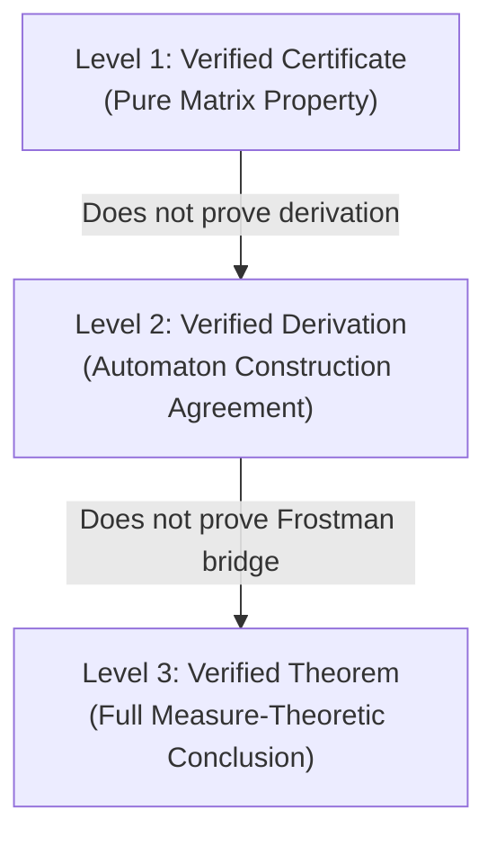

# EMVE External Technical Evaluation Kit

This evaluation kit provides an independent, zero-trust evaluation package for verifying exact spectral bounds and Perron roots on discrete transition matrices without running the EMVE search engine.

---

## 1. Five-Second Independent Verification

You only need Python 3 and the standalone auditor script. Run the following command from the repository root:

```bash
# Verify the Collatz-Wielandt witness for multiplier M = 19
python3 scripts/check_certificate.py certificates/M19_collatz_wielandt.json
```

**Expected terminal output (< 0.001 seconds):**
```text
Target File        : certificates/M19_collatz_wielandt.json
Problem ID         : erdos-cantor-multiplier:M=19:family=2:lag=(1,3)
Format Version     : emve-cert-v1
Cert Type          : collatz_wielandt
Integrity Checksum : a939b267b971c7a51fc448d6a2b4da028d9ec97d5f1aadfe0b64036bf579b1a2
Audit Status       : [PASS]
Proof Details      : Collatz-Wielandt verified: 5*(A@v) <= 8*v holds across all 6 rows. Proves rho(A) <= 8/5 = 1.60 < phi strictly.
Execution Time     : 0.0002s
```

For the proven extremizer $M=7$ (exact equality to the golden ratio $\phi$):
```bash
python3 scripts/check_certificate.py certificates/M7_sturm_extremizer.json
```

---

## 2. The Evaluation Deliverables

The evaluation kit consists of four self-contained components:

| Asset | Location | Role in Technical Due Diligence |
| :--- | :--- | :--- |
| **1. Standalone Checker** | [`scripts/check_certificate.py`](./scripts/check_certificate.py) | Lightweight mathematical auditor. Operates with **zero external dependencies** for Collatz–Wielandt (pure arbitrary-precision Python integers in $\mathbb{Z}$). |
| **2. Sample Portable Certificate** | [`certificates/M19_collatz_wielandt.json`](./certificates/M19_collatz_wielandt.json) | Self-contained JSON witness containing explicit $6 \times 6$ transition matrix $A$, integer vector $v$, and 64-character SHA-256 integrity checksum. |
| **3. Extremizer Certificate** | [`certificates/M7_sturm_extremizer.json`](./certificates/M7_sturm_extremizer.json) | Exact Sturm sequence witness in $\mathbb{Q}(\sqrt{5})$ proving $\rho(A_7) = \phi$ exactly. |
| **4. End-to-End Regression Test** | [`scripts/test_reproducibility.py`](./scripts/test_reproducibility.py) | Automated 6-stage test suite validating numerical consistency, raw witnesses, portable JSON certificates, and security hardening in $< 0.15$s. |

---

## 3. The Three-Level Verification Hierarchy

To avoid confusing algebraic checks with global mathematical claims, EMVE strictly separates verification into three independent tiers:



### Level 1: Verified Certificate (Witness Property)
- **What is verified:** The checker proves an exact mathematical property of the explicit matrix and vector inside the JSON ($5 A v \le 8 v \implies \rho(A) \le 8/5 = 1.60 < \phi$).
- **Trust base:** Pure arbitrary-precision integer arithmetic in $\mathbb{Z}$ (immune to floating-point and rounding errors).
- **Independence:** 100% independent of EMVE's BFS search engine, heuristic lag selection, and graph generation code.

### Level 2: Verified Derivation (Automaton Construction Agreement)
- **What is verified:** The checker verifies that the matrix $A$ and metadata (`family`, `forward_lag`, state counts) agree with the project's canonical carry automaton generator (`python3 scripts/check_certificate.py --verify-derivation`).
- **Trust base:** EMVE forward SFT graph traversal algorithm (`get_graph_for_M(M)`).
- **Limitation:** Verifies agreement with the generator code; it does *not* independently prove that the generator algorithm faithfully models the continuous Cantor problem.

### Level 3: Verified Theorem (Full Mathematical Conclusion)
- **What is verified:** The universal Hausdorff dimension bound $\dim_H C(1, M) \le \log_3 \phi$ on $\mathbb{R}$.
- **Trust base:** Kernel-checked Lean 4 theorems (`BridgeUniform.lean`), analytical Parry measure cylinder weight slack inequality (Hypothesis (H)), and the measure-theoretic Frostman bridge connecting symbolic path counts to Hausdorff measure on $\mathbb{R}$.

---

## 4. Summary of Guarantees & Trust Boundaries

| Question | Answer & Technical Guarantee |
| :--- | :--- |
| **Does certificate verification use floating-point numbers?** | **No.** Integer Collatz-Wielandt evaluation is pure $\mathbb{Z}$; Sturm root evaluation is exact rational field arithmetic $\mathbb{Q}(\sqrt{5})$. |
| **Can a corrupted or malformed certificate pass?** | **No.** Mandatory 64-character SHA-256 integrity checksums are enforced. Missing, empty, or mismatched checksums fail immediately. |
| **Can boolean values pass as integers?** | **No.** The auditor strictly rejects boolean values (`True`/`False`) in both matrix entries and witness vectors. |
| **Does the SHA-256 checksum prove author identity?** | **No.** The checksum is an integrity check against corruption. Authenticity requires out-of-band verification against signed Git release tags or the official Zenodo archive ([DOI: 10.5281/zenodo.24595631](https://zenodo.org/records/24595631)). |
| **Does the checker rely on heavy external libraries?** | Collatz-Wielandt has **zero external dependencies**. Sturm root-counting uses SymPy for polynomial algebra, evaluating root signs in exact field arithmetic. Both are decoupled from EMVE search heuristics. |
