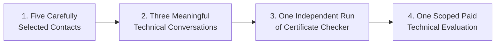

# Commercial Prospecting: Prioritized Segments & Technical Evaluation Framework

**Objective:** Approach high-alignment prospects with a concrete, low-risk **Technical Evaluation Proposal** grounded in machine-checkable mathematical verification.

---

## 1. Prioritized Customer Segments

Rather than treating all mathematical or computational groups as equally immediate prospects, target organizations are segmented by technical alignment and procurement feasibility:

### Priority Tier A: Immediate Technical Alignment (Primary Focus)

#### 1. Interactive Theorem Proving & Formal Math Research Labs
- **Target Profiles:** Research groups developing automated proof synthesis, benchmark suites, and formal mathematics libraries (e.g., Lean FRO, Cambridge Automated Reasoning Group, DeepMind Formal Math).
- **Core Value Proposition:** EMVE provides a complete, machine-checked bridge between combinatorial transfer matrices, exact algebraic root certificates, and Lean 4 Mathlib structures. It offers hard, verifiable ground-truth benchmarks for auto-formalization tools.
- **Engagement Strategy:** Offer EMVE's dual certificate generators as an automated pre-processor for Lean proof synthesis pipelines.

#### 2. Formal Verification Consultancies & High-Assurance Engineering
- **Target Profiles:** Specialized verification firms such as **Galois, Inc.**, **Runtime Verification**, and **Formal Land**.
- **Core Value Proposition:** These consultancies bid on high-assurance client and government verification contracts. EMVE demonstrates how to pair external computational algebra with kernel-verified proof assistants without bloating the trusted computing base.
- **Engagement Strategy:** Propose EMVE as a subcontracted exact verification engine for discrete transition and carry-automata verification tasks.

---

### Priority Tier B: Specialized Architectural Integrations (Secondary Focus)

#### 3. Zero-Knowledge VM & Arithmetic Circuit Teams
- **Target Profiles:** ZK engineering teams modeling carry behavior and arithmetic constraints (e.g., **StarkWare**, **Aztec Protocol**, **RISC Zero**).
- **Core Value Proposition:** Carry propagation across binary and ternary digit expansions models instruction-level carry overflow and constraint satisfaction.
- **Prerequisite:** Requires developing a concrete tutorial showing how EMVE's carry graphs map onto an actual ZK circuit or Algebraic Intermediate Representation (AIR) constraint check.

#### 4. Cloud Infrastructure Automated Reasoning Groups
- **Target Profiles:** **AWS Automated Reasoning Group**, Microsoft Research Automated Reasoning.
- **Core Value Proposition:** Scalable automated mathematical reasoning over discrete invariants, combining SMT solvers with exact quadratic number field Sturm sequences.

---

### Priority Tier C: Exploratory & Long-Term Targets

#### 5. Quantitative Trading & Algorithmic Research (Speculative)
- **Target Profiles:** Quantitative trading teams (e.g., **Jane Street**, **Renaissance Technologies**).
- **Honest Assessment:** Speculative. While these firms employ functional programming and discrete mathematicians, EMVE has not yet been demonstrated on an actual order-book or execution queuing problem. 
- **Recommendation:** Do not pitch EMVE as a financial tool until an explicit market microstructure mapping has been validated.

#### 6. Frontier AI Labs (Procurement & Security Overhead)
- **Target Profiles:** **OpenAI**, **Anthropic**, **Meta FAIR**.
- **Honest Assessment:** While these labs actively research mathematical reasoning, institutional procurement, NDA overhead, and large internal research teams make them difficult first customers for an early-stage solo product.
- **Recommendation:** Publish open benchmarks first; approach researchers via preprint citations and conference workshops.

---

## 2. Technical Outreach Strategy & Engagement Funnel

Rather than treating prominent researchers or engineering leads as immediate enterprise buyers or leading with a commercial evaluation proposal, our strategy follows a **peer-to-peer, question-first technical engagement model**.

### Our 4 Strategic Milestones



1. **Five Carefully Selected Technical Contacts:** Identify specific researchers and engineering leads whose ongoing work directly intersects automated proof synthesis, integer linear programming, or carry automata.
2. **Three Meaningful Technical Conversations:** Approach them with a concrete mathematical inquiry and architectural question—not a sales pitch or pricing tier.
3. **One Person Independently Running the Certificate Checker:** Provide a zero-friction, 5-second reproducible command so they can independently verify a portable JSON certificate on their own machine.
4. **One Opportunity to Scope a Paid Evaluation:** Once technical alignment and mutual interest are established, collaborate to scope a paid evaluation or custom certificate generation for their problem domain.

### Rules of Engagement
- **Lead with a technical question, not a commercial pitch:** Do not mention enterprise licensing tiers or pricing.
- **Demonstrate a concrete mathematical problem:** Center the communication on the arithmetic intersection of Cantor sets and transition matrix spectral certification.
- **Provide a 5-second reproducible witness:** Point directly to a portable JSON certificate and the standalone auditor.
- **Transparently disclose limitations:** Be upfront that the code certifies the zero-reachable forward component, while the full-graph spectral gap relies on Hypothesis~(H) and the dimension bridge is analytical.
- **Ask for technical feedback:** Seek their perspective on certificate ingestion and proof witness standards.

---

## 3. Concrete Priority Prospects & Technical Inquiry Angles

| Lead & Organization | Focus Area | Technical Inquiry Angle |
| :--- | :--- | :--- |
| **1. Leonardo de Moura / Sebastian Ullrich**<br>*(Lean FRO)* | Lean 4 core system, automated proof tactics, Mathlib infrastructure | **Inquiry on External Certificate Ingestion:** How does the Lean FRO view decoupled oracle/witness architectures where Python/Rust generates integer Collatz-Wielandt vectors or Sturm sign chains that a Lean tactic simply audits without executing the search? |
| **2. Christian Szegedy / Alex Davies**<br>*(Google DeepMind Formal Mathematics / AlphaProof)* | Auto-formalization, IMO-level automated reasoning, neural-symbolic math | **Inquiry on Ground-Truth Benchmark Suites:** Would formalization of non-linear carry-chains and affine SFT transition spectra serve as a useful benchmark for neural proof synthesis, where the neural model proposes vectors $v \in \mathbb{Z}^n$ and exact integer arithmetic validates them? |
| **3. Galois Reasoning Team / David Thrane Christiansen**<br>*(Galois, Inc. / Haskell Foundation)* | High-assurance software/hardware verification, SMT solvers, Lean 4 | **Inquiry on Discrete Carry Automata Verification:** How do your automated reasoning pipelines handle discrete transition matrix spectral bounds without falling back to floating-point numerical solvers? *(Contact: contact@galois.com, david@davidchristiansen.dk)* |
| **4. Grigore Roșu**<br>*(Runtime Verification, Inc.)* | K framework, blockchain virtual machines, proof-carrying code | **Inquiry on Portable Proof-Carrying Artifacts:** Runtime Verification champions proof-carrying code. We have defined a portable JSON certificate format (`emve-cert-v1`) with SHA-256 payload digests that an auditor checks in 0.001s. Does this schema match your requirements for external certification? |
| **5. Kevin Buzzard / Heather Macbeth**<br>*(Lean Mathematical Community / Imperial College London)* | Formalization of modern geometry & analysis in Lean 4 | **Inquiry on Symbolic Dynamics & Measure Formalization:** Mathlib's measure theory is expanding rapidly into dynamical systems. Would the combinatorial core of the Erdős 1939 problem (transfer matrix symmetry $P M P = M^T$) be of interest for an upcoming Mathlib formalization sprint? *(Contact: k.buzzard@imperial.ac.uk, h.macbeth@imperial.ac.uk)* |

---

## 4. Technical Outreach Email Template (Question-First, Zero Sales Pitch)

**Subject:** Technical inquiry: Decoupled integer certificates for transition matrix spectra (Erdős 1939 problem)

**Dear [Dr./Name],**

I have been following your work on [specific topic: Lean 4 tactics / automated reasoning / proof-carrying code]. In our recent investigation of arithmetic Cantor set intersections (Erdős 1939 problem; Zenodo DOI: [10.5281/zenodo.24595631](https://zenodo.org/records/24595631)), we encountered a recurring verification challenge: standard floating-point eigenvalue algorithms are susceptible to numerical instability when bounding spectral radii on ill-conditioned discrete transition matrices.

To eliminate floating-point error, we developed a decoupled certificate pattern:
1. **Integer Collatz-Wielandt Witness:** A strictly positive integer vector $v \in \mathbb{Z}_{>0}^n$ proving $\rho(A) \le 8/5 = 1.60 < \phi$ via exact arbitrary-precision integer inequality ($5 A v \le 8 v$).
2. **Exact Algebraic Root Counting:** Exact Sturm sign chains in the quadratic field $\mathbb{Q}(\sqrt{5})$ proving candidate extremizers attain $\rho(A) = \phi$ exactly.
3. **Portable JSON Certificates (`emve-cert-v1`):** Self-contained, SHA-256 hashed JSON artifacts that a recipient can audit in milliseconds without running or trusting our search engine:
   ```bash
   python3 scripts/check_certificate.py certificates/M19_collatz_wielandt.json
   ```

**Trust boundary transparency:** We explicitly distinguish what is automated from what is analytical: our software certifies the spectral radius of the zero-reachable forward subgraph; global two-sided uniqueness in the interior domain remains conditional on an analytical spectral-gap hypothesis (H), and the measure-theoretic Frostman bridge connecting word counts to Hausdorff dimension on $\mathbb{R}$ is an analytical paper proof.

I would value your technical critique: from your perspective in [their specific area], do you see utility in decoupling heuristic graph searches from lightweight, portable integer certificates for proof verification pipelines?

The standalone auditor and portable certificates are open for inspection at:  
https://github.com/ezzasdf/erdos-problem-engine

Thank you very much for your time and research.

Best regards,

**Ezzeldin Ashraf Mohamed Shafey Wahba**  
`ezzeldinashraf.web@gmail.com`  
https://github.com/ezzasdf/erdos-problem-engine
