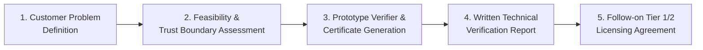

# Commercial Prospecting: Prioritized Segments & Technical Evaluation Framework

**Objective:** Approach high-alignment prospects with a concrete, low-risk **Technical Evaluation Proposal** grounded in machine-checkable mathematical verification.

---

## 1. Prioritized Customer Segments

Rather than treating all mathematical or computational groups as equally immediate prospects, target organizations are segmented by technical alignment and procurement feasibility:

### Priority Tier A: Immediate Technical Alignment (Primary Focus)

#### 1. Interactive Theorem Proving & Formal Math Research Labs
- **Target Profiles:** Research groups developing automated proof synthesis, benchmark suites, and formal mathematics libraries (e.g., Lean FRO, Cambridge Automated Reasoning Group, DeepMind Formal Math).
- **Core Value Proposition:** EMVE provides a complete, machine-checked bridge between combinatorial transfer matrices, exact algebraic root certificates, and Lean 4 Mathlib structures. It offers hard, verifiable ground-truth benchmarks for auto-formalization tools.
- **Engagement Strategy:** Offer EMVE's dual certificate generators as an automated pre-processor for Lean proof synthesis pipelines.

#### 2. Formal Verification Consultancies & High-Assurance Engineering
- **Target Profiles:** Specialized verification firms such as **Galois, Inc.**, **Runtime Verification**, and **Formal Land**.
- **Core Value Proposition:** These consultancies bid on high-assurance client and government verification contracts. EMVE demonstrates how to pair external computational algebra with kernel-verified proof assistants without bloating the trusted computing base.
- **Engagement Strategy:** Propose EMVE as a subcontracted exact verification engine for discrete transition and carry-automata verification tasks.

---

### Priority Tier B: Specialized Architectural Integrations (Secondary Focus)

#### 3. Zero-Knowledge VM & Arithmetic Circuit Teams
- **Target Profiles:** ZK engineering teams modeling carry behavior and arithmetic constraints (e.g., **StarkWare**, **Aztec Protocol**, **RISC Zero**).
- **Core Value Proposition:** Carry propagation across binary and ternary digit expansions models instruction-level carry overflow and constraint satisfaction.
- **Prerequisite:** Requires developing a concrete tutorial showing how EMVE's carry graphs map onto an actual ZK circuit or Algebraic Intermediate Representation (AIR) constraint check.

#### 4. Cloud Infrastructure Automated Reasoning Groups
- **Target Profiles:** **AWS Automated Reasoning Group**, Microsoft Research Automated Reasoning.
- **Core Value Proposition:** Scalable automated mathematical reasoning over discrete invariants, combining SMT solvers with exact quadratic number field Sturm sequences.

---

### Priority Tier C: Exploratory & Long-Term Targets

#### 5. Quantitative Trading & Algorithmic Research (Speculative)
- **Target Profiles:** Quantitative trading teams (e.g., **Jane Street**, **Renaissance Technologies**).
- **Honest Assessment:** Speculative. While these firms employ functional programming and discrete mathematicians, EMVE has not yet been demonstrated on an actual order-book or execution queuing problem. 
- **Recommendation:** Do not pitch EMVE as a financial tool until an explicit market microstructure mapping has been validated.

#### 6. Frontier AI Labs (Procurement & Security Overhead)
- **Target Profiles:** **OpenAI**, **Anthropic**, **Meta FAIR**.
- **Honest Assessment:** While these labs actively research mathematical reasoning, institutional procurement, NDA overhead, and large internal research teams make them difficult first customers for an early-stage solo product.
- **Recommendation:** Publish open benchmarks first; approach researchers via preprint citations and conference workshops.

---

## 2. The Technical Evaluation Proposal Framework

Rather than pitching rigid enterprise software tiers (\$10,000–\$75,000) upfront before validating customer requirements, approach prospects with a **Structured Technical Evaluation**:

### The 5-Step Evaluation Workflow

1. **Customer Problem Definition:**  
   The customer specifies a discrete dynamical system, transition graph, or arithmetic carry constraint matrix whose spectral radius, boundedness, or invariant language needs rigorous certification.
2. **Feasibility & Trust Boundary Assessment:**  
   We assess whether the problem can be reduced to an affine SFT, carry automaton, or quadratic number field Sturm sequence, and deliver an explicit written statement of what can and cannot be certified.
3. **Prototype Verifier Execution:**  
   Execute the exact certificate generator to produce machine-auditable certificates (integer Collatz-Wielandt vectors or Sturm sign chains) free of floating-point error.
4. **Written Technical Verification Report:**  
   Deliver a comprehensive technical report documenting:
   - The exact algebraic witnesses generated.
   - The execution runtime and memory benchmarks.
   - The precise trust boundary (assumptions made vs. properties certified).
   - An independent reproducibility script for customer validation.
5. **Commercial Conversion:**  
   Upon successful validation of the deliverable, negotiate an ongoing commercial license (Tier 1 internal research or Tier 2 system integration) priced according to the customer's operational scale.
